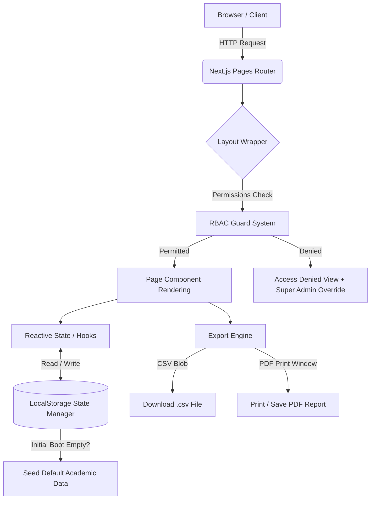

<div align="center">

  

  # 🏫 EduCore - Next-Gen Enterprise School Management System

  **A school ERP UI prototype built with Next.js, React, and Vanilla CSS, with dynamic academics and student fee workflows.**

  [](https://nextjs.org/)
  [](https://reactjs.org/)
  [](https://school-gules.vercel.app/)
  [](https://developer.mozilla.org/en-US/docs/Web/CSS)
  
  [](CONTRIBUTING.md)

  <br />

  ### 🌐 Earlier demo URL (current deployment unverified): [https://school-gules.vercel.app/](https://school-gules.vercel.app/)

  ---

  [🚀 Live Demo](https://school-gules.vercel.app/) • [Key Features](#-key-feature-ecosystem) • [Architecture](#-system-architecture--data-flow) • [Tech Stack](#-technology-stack) • [Installation](#-installation--getting-started) • [RBAC Matrix](#-role-based-access-control-rbac)


</div>

<br />

---

> [!IMPORTANT]
> **Current status — 16 October 2026:** UI/UX prototype with browser-local records, not a production school operations service. No database, authentication, payment gateway or message delivery is connected. The demo link above comes from the supplied README; its current deployed version has not been verified. Role names describe prototype permissions, not implemented portals for every role.

## 📌 Table of Contents

- [🌟 Mission, Vision, Aim & Core Philosophy](#-mission-vision-aim--core-philosophy)
  - [🎯 Mission](#-mission)
  - [👁️ Vision](#️-vision)
  - [⚡ Aim](#-aim)
  - [🧠 Thinking & Mindset](#-thinking--mindset)
- [🚀 Technology Stack](#-technology-stack)
- [📊 System Architecture \& Data Flow](#-system-architecture--data-flow)
- [✨ Key Feature Ecosystem](#-key-feature-ecosystem)
  - [📊 1. Executive Dashboard \& Analytics](#1-executive-dashboard--analytics)
  - [👥 2. People \& Directory Management](#2-people--directory-management)
  - [🏫 3. Academic Structure \& Timetable Scheduler](#3-academic-structure--timetable-scheduler)
  - [📊 4. Examinations, Admit Cards \& Report Cards](#4-examinations-admit-cards--report-cards)
  - [⏱️ 5. Real-Time Attendance Tracker](#5-real-time-attendance-tracker)
  - [💰 6. Financial Suite (Fees, Payroll \& Auditing)](#6-financial-suite-fees-payroll--auditing)
  - [📚 7. Library Information System](#7-library-information-system)
  - [🚌 8. Fleet \& Transport Operations](#8-fleet--transport-operations)
  - [🔐 9. Granular Role-Based Access Control (RBAC)](#9-granular-role-based-access-control-rbac)
  - [🎨 10. System Customization \& UI Engine](#10-system-customization--ui-engine)
  - [🎂 11. Campus Feed \& Milestone Celebrations](#11-campus-feed--milestone-celebrations)
- [🔐 Role-Based Access Control (RBAC) Matrix](#-role-based-access-control-rbac-matrix)
- [📁 Project Directory Structure](#-project-directory-structure)
- [💻 Installation \& Getting Started](#-installation--getting-started)
  - [📋 Prerequisites](#-prerequisites)
  - [🛠️ Step-by-Step Setup](#️-step-by-step-setup)
  - [🌐 Pinggy Remote Tunnel Sharing](#-pinggy-remote-tunnel-sharing)
- [🎨 UI/UX Design System \& Theme Engine](#-uiux-design-system--theme-engine)
- [💾 Data Persistence \& Seed Architecture](#-data-persistence--seed-architecture)
- [🗺️ Future Roadmap](#-future-roadmap)
- [🤝 Contributing](#-contributing)
- [💰 Updated fee-system workflows](#updated-fee-system)
- [📚 Current documentation and verification](#current-documentation)
- [📜 License](#-license)

---

## 🌟 Mission, Vision, Aim & Core Philosophy

### 🎯 Mission
To revolutionize educational administration by replacing bloated, fragmented software with a unified, lightning-fast, and visually captivating management suite. **EduCore** simplifies daily workflows for school administrators, teachers, accountants, librarians, students, and parents through intelligent automation and human-centric design.

### 👁️ Vision
To set the global benchmark for modern school ERP solutions—enabling educational institutions worldwide to focus on what matters most: **delivering exceptional learning experiences**—supported by responsive administrative tools and crystal-clear data governance.

### ⚡ Aim
- **Simple Workflows**: Develop a school ERP with a lightweight, custom UI.
- **Responsive Design**: Build layouts for desktop and mobile; targeted checks do not guarantee every device.
- **Local Prototyping**: Persist demo records in browser storage and provide CSV exports and browser-print views. Full offline synchronization is future work.
- **Role Preview**: Demonstrate UI permissions. Authentication and server-enforced authorization are future work.

### 🧠 Thinking & Mindset
```
                              ┌────────────────────────┐
                              │ Human-Centric UI/UX   │
                              └───────────┬────────────┘
                                          │
                  ┌───────────────────────┴───────────────────────┐
                  ▼                                               ▼
     ┌────────────────────────┐                      ┌────────────────────────┐
     │  Granular Security &   │                      │  Browser-Local    │
     │  Dynamic RBAC Guard    │                      │  State Persistence     │
     └────────────────────────┘                      └────────────────────────┘
                  │                                               │
                  └───────────────────────┬───────────────────────┘
                                          ▼
                              ┌────────────────────────┐
                              │  Empowered Educational │
                              │      Institutions      │
                              └────────────────────────┘
```

> [!IMPORTANT]
> **EduCore** is engineered with a **Client-First Mindset**. Supported mutations persist in browser storage; missing demo keys are seeded without intentionally replacing existing records. Browser storage can fail or be cleared.

---

## 🚀 Technology Stack

| Layer | Technology | Version | Purpose / Functionality |
| :--- | :--- | :--- | :--- |
| **Frontend Framework** | **Next.js** | `16.4.0` | React framework providing Pages routing, server-side dynamic head tags, fast refreshes, and production bundling. |
| **UI Library** | **React** | `18.2.0` | Declarative UI state management, hooks (`useState`, `useEffect`, `useMemo`, `useRef`), and reactive component hierarchy. |
| **Styling Engine** | **Vanilla CSS3** | Custom | Custom Design System (`globals.css`) built with HSL CSS variables, glassmorphism, fluid flexbox/grid layout math, and responsive breakpoints. |
| **Icons & Typography** | **FontAwesome 6** + **Inter Font** | `6.x` | High-fidelity vector iconography (`fa-solid`, `fa-brands`) paired with Google Inter modern typography. |
| **State Persistence** | **LocalStorage Engine** | Native | Reactive sync via `academicData.js` keys (`educore.students`, `educore.staff`, `educore.roles`, etc.) with fallback seed data. |
| **Report Generation** | **Custom CSV / PDF Exporter** | Native | Client-side CSV generation (`exportToCSV`) and inline dynamic print-to-PDF engine (`printToPDF`) with custom header/footer styling. |
| **Remote Tunneling** | **Pinggy SSH** | Latest | Embedded script (`npm run share`) for instant multi-device external testing over public HTTPS. |

---

## 📊 System Architecture & Data Flow



---

## ✨ Key Feature Ecosystem

### 📊 1. Executive Dashboard & Analytics
- **Local KPIs**: Track total students, active staff, fee collection metrics, average attendance percentage, and class statistics at a glance.
- **Interactive Quick Actions**: Direct action cards for rapid student admissions, fee payments, attendance logging, and exam creation.
- **Campus Activity Feed**: Local activity timeline showcasing recent system events, fee receipts, and updates.

### 👥 2. People & Directory Management
- **Student Information System (SIMS)**: Complete student records with roll numbers, assigned class & section, guardian details, blood group, contact numbers, status filters, and modal CRUD operations.
- **HR & Faculty Directory**: Complete staff management (Teaching & Non-Teaching), designations, subject assignments, salary packages, and active/inactive status switches.
- **Parent Directory**: Detailed guardian profiles linked to multiple children/wards, emergency contacts, occupation, and communication preferences.

### 🏫 3. Academic Structure & Timetable Scheduler
- **Class & Section Configurator**: Grade levels, section allotment, room numbers, class teacher assignment, and seat capacity controls.
- **Subject & Curriculum Catalog**: Compulsory vs. optional subjects, course codes, publication names, textbook titles, and code references.
- **Interactive Timetable Scheduler**: Period slot configurator, weekday schedule matrix, teacher allotment, and conflict-prevention layout.

### 📊 4. Examinations, Admit Cards & Report Cards
- **Exam Management**: Configure term exams (Unit Tests, Mid-Terms, Annuals), max marks, passing criteria, and subject-wise score entries.
- **Admit Card Generator**: Automated student examination pass/admit card layout ready for instant batch printing.
- **Report Card Engine**: Automated percentage computation, grade allocation (A+, A, B, C, F), class rank calculations, and official transcript PDF generation.

### ⏱️ 5. Real-Time Attendance Tracker
- **Daily Attendance Marking**: Student & staff mark sheets with status toggles (`Present`, `Absent`, `Late`, `Excused`).
- **Date Picker & Class Filter**: Filter attendance records by specific calendar dates and class sections.
- **Monthly Percentage Summaries**: Visual attendance indicators and summary metrics for institutional compliance.

### 💰 6. Financial Suite (Fees, Payroll & Auditing)
- **Fee Management & Invoicing**: Custom fee category breakdown (Tuition, Bus Fee, Exam Fee, Admission), due date trackers, and partial/full payment logs.
- **Printable Fee Receipts**: Professional receipt generator with transaction IDs, payment methods, and breakdown tables.
- **Staff Payroll System**: Staff salary processing, basic pay, allowances, deductions, net salary calculation, and payslip export.
- **Financial Audit Ledger**: Comprehensive revenue vs. expense overview for financial transparency.

### 📚 7. Library Information System
- **Book Cataloging**: ISBN indexing, book titles, author details, publisher tags, copies available, and shelf placement.
- **Borrowing & Return Engine**: Student/staff book issuance logging, return due dates, and fine calculation engine for overdue returns.

### 🚌 8. Fleet & Transport Operations
- **Vehicle Fleet Register**: Bus vehicle numbers, seating capacities, driver names, license numbers, and maintenance status.
- **Route & Stop Allocator**: Pickup and drop-off route management, stop timing configuration, and fee mapping per route.

### 🔐 9. Granular Role-Based Access Control (RBAC)
- **Example Role Catalog**: Super Admin, Senior Teacher, Junior Teacher, Class Teacher, Exam Coordinator, Librarian, Accountant, Transport Manager, Hostel Warden, Reception Desk.
- **Module Permission Matrix**: Control view, create, edit, delete, export, and approve actions per module.
- **Live Topbar Role Switcher**: Instant role switching capability for testing permissions without re-authenticating.

### 🎨 10. System Customization & UI Engine
- **Dark / Light Mode**: Theme toggle saved across user sessions via root dataset attributes (`data-theme`).
- **Dynamic Accent Color Swatches**: Real-time CSS variable manipulation (`--accent`, `--accent2`) with custom swatch choices (`#6366F1`, `#2563EB`, `#7C3AED`, `#D946EF`, `#EA580C`, `#16A34A`).
- **Resizable Drag Sidebar**: Dynamic sidebar width dragging (180px to 420px) with collapsed mode support and hovering tooltips.
- **Academic Year Switcher**: Configure active session years (e.g., `2025–2026`, `2026–2027`) and board affiliations (CBSE, ICSE, IB, State Board).

### 🎂 11. Campus Feed & Milestone Celebrations
- **Celebration Board**: Automated birthday alert system for students and staff with custom digital greeting previews.
- **Events & Feed Timeline**: Chronological school feed for announcements, sports meets, holidays, and parent-teacher meetings.

---

## 🔐 Role-Based Access Control (RBAC) Matrix

This table retains the original role overview. It is illustrative: consult the app's current permission settings for actual grants. Hostel rooms, visitor logs and standalone parent/student portals are not implemented modules. Scope labels are planning metadata and do not enforce record isolation.

| Role Name | Role Code | Type | Default Permissions Highlights | Status |
| :--- | :--- | :--- | :--- | :--- |
| **Super Admin** | `SUPER-ADMIN` | System | Full administrative access to all 15+ modules & system settings | `Active` |
| **Senior Teacher** | `ROLE-TEACH-SR` | Teaching | Students, Classes, Subjects, Timetable, Exams (Approve), Attendance | `Active` |
| **Junior Teacher** | `ROLE-TEACH-JR` | Teaching | View Students, Classes, Subjects, Attendance (Create/Edit) | `Active` |
| **Class Teacher** | `ROLE-TEACH-CT` | Teaching | Assigned Students, Parents, Attendance (Full), Class Announcements | `Active` |
| **Exam Coordinator** | `ROLE-TEACH-EC` | Teaching | Examinations (Full + Approve), Admit Cards, Report Cards, Marks | `Active` |
| **Accountant** | `ROLE-NT-ACC` | Non-Teaching | Fees (Full + Approve), Payroll, Financial Audit, Receipts | `Active` |
| **Librarian** | `ROLE-NT-LIB` | Non-Teaching | Library Catalog, Book Borrowings, Fines, Student/Staff Lookup | `Active` |
| **Transport Manager** | `ROLE-NT-TRN` | Non-Teaching | Transport Routes, Vehicle Fleet, Bus Assignments | `Active` |
| **Hostel Warden** | `ROLE-NT-HST` | Non-Teaching | Hostel Rooms, Student Allocation, Night Attendance | `Active` |
| **Reception Desk** | `ROLE-NT-REC` | Non-Teaching | Visitor Logs, Student Lookup, Parent Directory, Announcements | `Active` |

---

## 📁 Project Directory Structure

Original high-level route overview; the current repository also includes `tests/`, `scripts/`, `docs/`, billing/calendar helpers and shared fee editors. The named `_error.js` in this overview is historical, not a required current file.

```
educore-next/
├── 📁 components/                  # Modular React UI Components
│   ├── Layout.js                   # Main application layout, topbar & authorization interceptor
│   ├── Sidebar.js                  # Dynamic resizable sidebar with drag resizer & collapse mode
│   ├── RolesPage.js                # Full RBAC management console & permission matrix
│   ├── RoleDetailModal.js          # Modal view for role details & permission audits
│   ├── RoleFormModal.js            # Modal editor for creating & modifying roles
│   └── SettingsTabs.js             # School settings, board selection, accent swatches & toasts
│
├── 📁 lib/                         # Core Business Logic & Data Engine
│   ├── academicData.js             # Seed database, LocalStorage keys & default initializers
│   └── exportUtils.js              # Client-side CSV generator & dynamic HTML print engine
│
├── 📁 pages/                       # Next.js Pages Routing System
│   ├── _app.js                     # Application entry point, global CSS & accent color restorer
│   ├── _document.js                # Custom HTML document wrapper with FontAwesome & Google Fonts
│   ├── _error.js                   # Custom error boundary component
│   ├── index.js                    # Executive Dashboard overview
│   ├── dashboard.js                # Executive Dashboard view mapping
│   ├── students.js                 # Student Information Management System (SIMS)
│   ├── staff.js                    # HR & Faculty Management
│   ├── parents.js                  # Parent & Guardian Portal
│   ├── classes.js                  # Class & Section Configuration
│   ├── subjects.js                 # Curriculum & Subject Mapping
│   ├── timetable.js                # Interactive Weekly Timetable Scheduler
│   ├── examinations.js             # Exam Scores, Marks Entry & Report Cards
│   ├── exam-routine.js             # Exam Timetable & Admit Card Generator
│   ├── attendance.js               # Daily Attendance Tracker
│   ├── library.js                  # Library Catalog & Borrowings
│   ├── transport.js                # Fleet & Transport Management
│   ├── fees.js                     # Fee Structure & Receipts Engine
│   ├── salary.js                    # Payroll & Staff Salary Slips
│   ├── finance.js                  # Financial Audit & Accounting
│   ├── roles.js                    # Role-Based Access Control Panel
│   ├── settings.js                 # School Configuration & Personalization
│   ├── birthdays.js                # Celebration Feed & Birthday Cards
│   └── timeline.js                 # Campus News & Event Announcements
│
├── 📁 styles/                      # Global Stylesheet & Design System Tokens
│   └── globals.css                 # 100% Vanilla CSS design system variables, components & utilities
│
├── 📄 next.config.js               # Next.js configuration
├── 📄 package.json                 # Project manifest, dependencies & npm scripts
├── 📄 package-lock.json            # Dependency lockfile
├── 📄 .gitignore                   # Git ignore patterns
└── 📄 README.md                    # Project documentation (You are here!)
```

---

## 💻 Installation & Getting Started

Follow this guide to run **EduCore** locally. Installation time depends on your machine and network.

### 📋 Prerequisites

Ensure you have the following installed on your operating system:
- **Node.js**: `22.x` ([Download Node.js](https://nodejs.org/))
- **npm**: the version bundled with Node.js 22
- **Git**: `v2.x` or higher ([Download Git](https://git-scm.com/))

Check your local environment versions:
```bash
node -v
npm -v
git --version
```

---

### 🛠️ Step-by-Step Setup

#### 1. Clone the Repository
```bash
git clone https://github.com/Rajan-Prasaila-Yadav/scl.git
cd scl
git switch feature/dynamic-academics-and-fees
```

#### 2. Install Dependencies
Install all core dependencies cleanly:
```bash
npm ci
```

#### 3. Launch Development Server
Start the local development server with hot-reloading:
```bash
npm run dev
```

Once started, open your web browser and navigate to:
```
http://localhost:3000
```

> [!TIP]
> The app comes seeded with demo records for school modules; attendance begins unmarked. No database setup required.

#### 4. Build for Production (Optional)
To test or deploy a production-optimized build:
```bash
npm run validate
npm run start
```

---

### 🌐 Pinggy Remote Tunnel Sharing

Want to test **EduCore** on a mobile phone or share a live demo URL with stakeholders instantly without deploying?

Run the pre-configured Pinggy SSH script:
```bash
npm run share
```
This command exposes `localhost:3000` over a secure HTTPS public pinggy URL (e.g. `https://xxx.pinggy.link`) ready for instant device testing!

---

> [!NOTE]
> On Windows PowerShell, use `npm.cmd` if `npm` is blocked by execution policy. Restart production preview after every rebuild. Browser data is separate for each hostname, port and browser. Tunnel sharing exposes the unauthenticated prototype publicly; use demo data only.

## 🎨 UI/UX Design System & Theme Engine

EduCore features a custom-built Vanilla CSS architecture defined in `styles/globals.css`. It uses **CSS Custom Properties** (Variables) for instant theme switching and accent customization.

### Core CSS Tokens

Illustrative tokens from the reference design; `styles/globals.css` is authoritative for current values.
```css
:root {
  --accent: #6366F1;          /* Primary Accent (Indigo) */
  --accent2: #6366F1CC;        /* Translucent Accent */
  --bg: #0F172A;              /* Page Background */
  --bg2: #1E293B;             /* Card / Container Background */
  --bg3: #334155;             /* Input / Border Background */
  --t1: #F8FAFC;              /* Primary Text Color */
  --t2: #94A3B8;              /* Secondary Muted Text */
  --radius-sm: 6px;           /* Small Border Radius */
  --radius-md: 10px;          /* Medium Border Radius */
  --radius-lg: 16px;          /* Card Border Radius */
  --shadow: 0 10px 25px -5px rgba(0, 0, 0, 0.3);
}
```

---

## 💾 Data Persistence & Seed Architecture

EduCore uses a reactive **Client-Side Storage Engine** managed through `lib/storage.js`, with fixtures in `lib/academicData.js` and startup seeding in `lib/seed.js`. Supported record changes persist to the browser's `localStorage` under isolated key namespaces:

| Storage Key | Data Contents |
| :--- | :--- |
| `educore.students` | Full list of enrolled students, classes, parents, blood groups |
| `educore.staff` | Employee list, designations, salaries, role codes |
| `educore.roles` | Custom and default RBAC role objects with permission arrays |
| `educore.classes` | Grade levels, room numbers, allocated class teachers |
| `educore.subjects` | Subject names, publication details, course codes |
| `educore.timetable` | Weekly schedule slots per class & period |
| `educore.books` | Library catalog, available quantities, ISBNs |
| `educore.vehicles` | Transport bus fleet, driver contact details, routes |

---

## 🗺️ Future Roadmap

Checked phases refer to prototype implementation, not production readiness. Later technologies are possibilities, not installed services; see [backend planning](docs/backend-planning/README.md) for current recommendations.

- [x] **Phase 1: Core Foundation Prototype** (SIMS, HR, Timetable, Exams, Fees, Library, RBAC)
- [x] **Phase 2: UI Engine & Exporter Prototype** (Dark/Light mode, Accent Picker, CSV Export, PDF Printer)
- [ ] **Phase 3: Backend & Database Integration** (Node.js Express / Next.js API Routes + PostgreSQL / Supabase)
- [ ] **Phase 4: Real-time Communication** (Socket.io Parent-Teacher Chat & Push Notifications)
- [ ] **Phase 5: Mobile App Companion** (React Native / PWA for Android & iOS)
- [ ] **Phase 6: AI Analytics** (Predictive student performance trends & automated timetabling)

---

<a id="updated-fee-system"></a>
## 💰 Updated fee-system workflows — 16 October 2026

The following extends the original Financial Suite description with the work implemented on `feature/dynamic-academics-and-fees`.

### 1. Set the academic year

In Settings, configure the year label, start/end dates and **AD or Nepali BS** calendar, then activate the intended year. Fee activation dates must stay inside that active year. Canonical dates are stored in AD; supported billing inputs and periods use the selected calendar.

### 2. Create fee headings

In **Fee Management → Fee Configurator**, create or edit the heading name, description, default amount, frequency and status. Supported frequencies: **Hourly, Daily, Weekly, Monthly, One-Time and Yearly**. Examination fees can be configured as a named heading with the appropriate supported frequency.

Heading edits save independently of class activation dates. A heading can exist before it is assigned to a class.

### 3. Apply amounts and dates to classes

| Individual setup | Bulk class fee setup |
| :--- | :--- |
| Choose a class and edit one heading's amount, start/end dates and status. | Choose a class, load active headings and edit multiple fee rows together. |
| Save only that heading's class settings. | Save the entire validated draft in one operation. |
| Reactivate or deactivate the class assignment. | Duplicate headings and invalid amounts/dates prevent the whole save. |

Class-specific rates override the default. Removing a saved bulk row or disabling an individual assignment stops future billing for that class/year while retaining history. Existing issued invoices keep their saved amounts.

### 4. Apply student concessions

Student fee customizations can inherit the class rate, specify a custom rate, apply a percentage/fixed concession or increase, or fully waive an item. These settings affect future bills. Invoice items retain the applied concession snapshot.

### 5. Build an individual student's bill

Choose academic year, class and student in the dedicated bill builder. Review applicable headings, rates, existing invoices and periods before generating. Combine different frequencies in one bill; recurring items use the selected quantity. One-time/yearly items use one unit.

Monthly coverage follows the configured calendar, includes whole billing months without day proration, and is bounded by the assignment end month and a twelve-month cap. Already-billed periods are protected against duplicate billing, including periods reserved by unpaid or partially paid invoices.

Bill discount, tax and penalty accept percentage or fixed values. Printed invoices include student/class/year details, fee periods, totals in figures and words, collected amount, balance and spaces for physical stamp/signature. No official signature or stamp is fabricated.

### 6. Collect and review

Collect all or part of an invoice balance. Record payer name, an explicit relationship, collector and payment method. Custom relationship names are reusable and manageable. Further payments reduce the same invoice balance; each collection retains its receipt/history.

Class detail, student statement and Fee Management use shared billing records. Due dates determine overdue timing separately from payment status, so a partially paid invoice may also be overdue. Payment timestamps retain time; fee periods use date-focused display.

> [!NOTE]
> Academic years support billing settings, invoice metadata and reporting, but there is no historical enrollment engine or versioned class-rate history. Review back-year rates explicitly. No automatic arrears migration, scheduled penalties or reminders are implemented.

<a id="current-documentation"></a>
## 📚 Current documentation and verification

| Guide | Contents |
| :--- | :--- |
| [Project status](PROJECT-STATUS.md) | Current milestone and limitations |
| [Dynamic academics and fees](docs/DYNAMIC-ACADEMICS-AND-FEES.md) | Detailed changes, calendar rules and browser verification |
| [Architecture](ARCHITECTURE.md) | Implemented modules and future backend boundaries |
| [Backend planning](docs/backend-planning/README.md) | Database, Nepal performance, security, Docker and roadmap |
| [ERP diagrams](docs/backend-planning/diagrams/README.md) | Proposed people, roles and module relationships |
| [Release notes](CHANGELOG.md) | Checkpoints and change history |
| [Deployment guide](DEPLOYMENT.md) | Publishing and frozen release preservation |

Latest application verification on **16 October 2026** passed **41 regression tests**, source checks and the production build. Targeted browser checks confirmed individual heading saves and class status persistence after reload. This README-only revision did not rerun application tests.

`npm run validate` runs source checks, tests and production build. Node.js 22.x is required; React and React DOM are pinned to 18.2.0 and Next.js to 16.4.0. Calendar conversion uses `nepali-date-converter` 3.4.0 (BS 2000–2090). The current build emits React 18 deprecation and Node module-type warnings.

Attachments use IndexedDB (`educore-files`), up to 10 MB per new attachment. Branding images are limited to 250 KB. The storage backup includes metadata, not attachment bytes. CSV exports are CSV; PDF actions use the browser's print/Save as PDF flow. Currency changes presentation only. Communication preferences and birthday drafts do not send messages. Fonts/icons may require internet.

The original `v0.1.0-prototype` tag and `release/prototype-v0.1.0` branch remain at `d4cc547`. Current feature development does not rewrite that baseline. GitHub stores source, not browser records; a successful push does not confirm a live deployment. Historical audit/migration scripts must not be rerun as installation steps.

---

## 🤝 Contributing

Contributions make the open-source community an amazing place to learn, inspire, and create. Any contributions you make are **greatly appreciated**!

1. Fork the Project
2. Create your Feature Branch (`git checkout -b feature/AmazingFeature`)
3. Commit your Changes (`git commit -m 'Add some AmazingFeature'`)
4. Push to the Branch (`git push origin feature/AmazingFeature`)
5. Open a Pull Request

---

## 📜 License

No project license file has been supplied. No MIT or other project licensing terms are asserted here. Dependency licenses are separate.

---

<div align="center">

  **EduCore School Management System** • Built with ❤️ for Modern Education

  [Back to Top ⬆️](#-educore---next-gen-enterprise-school-management-system)

</div>
