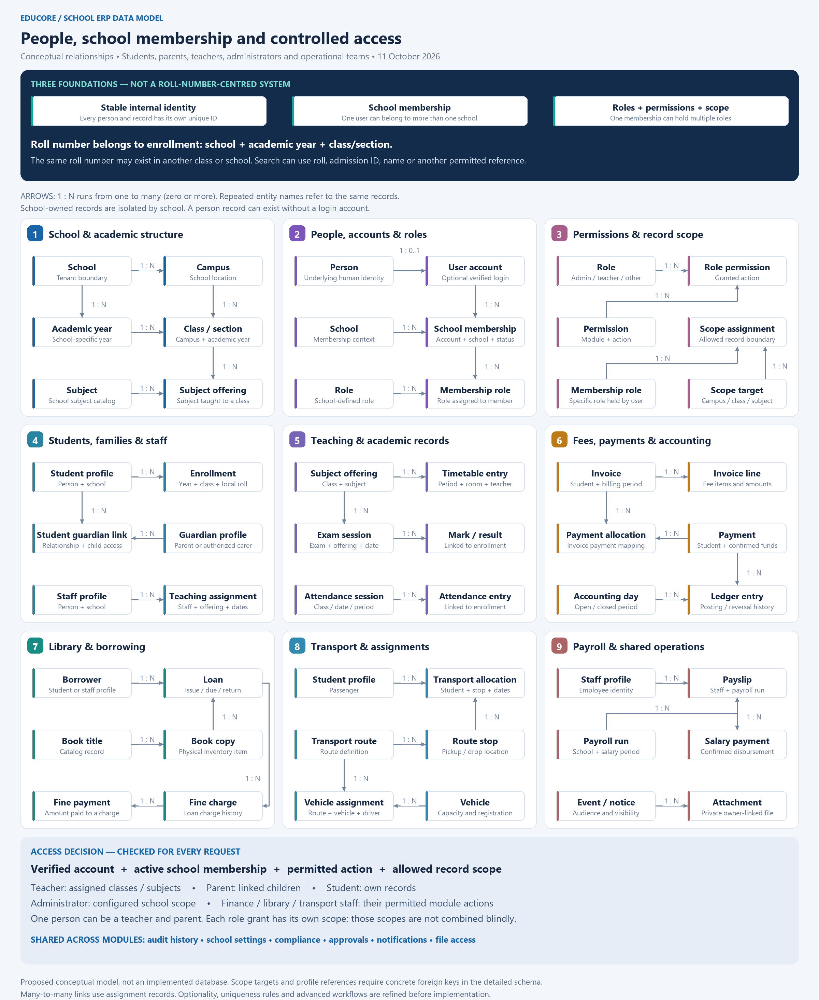

# ERP relationship diagrams

Connected ERP system overview: [SVG](erp-system-overview.svg) or [PNG](erp-system-overview.png). This shows people, access checks and business modules. The database relationship diagram below provides the entity-level view.

Current proposal, 11 October 2026: [People, roles and modules — SVG](erp-people-roles-and-modules.svg) or [PNG](erp-people-roles-and-modules.png).

This conceptual overview separates internal record identity, optional user accounts, school memberships, role grants and record scopes. Students, guardians and staff are distinct profiles; a person can participate in more than one capacity. Role scopes must be evaluated with the applicable role rather than combined into an unintended privilege grant.

Roll number is an enrollment reference scoped to school, academic year and class/section. It may repeat elsewhere and must not be used as the global identity or proof of access. Search may use multiple permitted references. Detailed schema design must define concrete foreign keys, uniqueness and enforcement rules.

The earlier `erp-roll-number-database-diagram` images are superseded: their permanent-roll-number assumption was rejected by the owner. They are retained only as design history. Neither diagram represents an implemented database.

